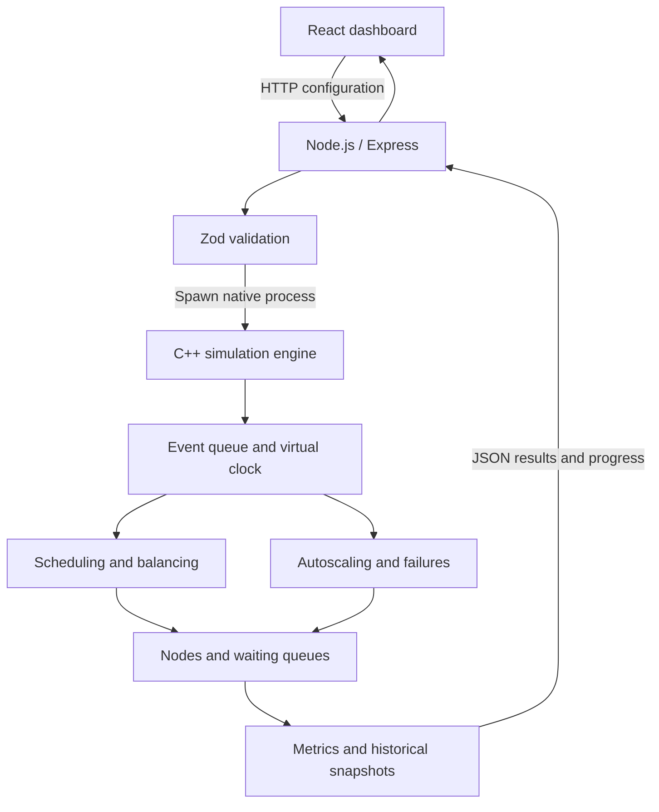

# Cloud Event Simulator

An interactive discrete-event simulator for exploring cloud scheduling, load balancing, autoscaling, and failure recovery. Configure virtual clusters, replay workload decisions, and compare performance, resource use, and simulated cost across policies.

## Features

- **Workload configuration:** Quick Start and Advanced controls for server capacity, request arrival rates, execution times, resource requirements, priorities, and traffic spikes.
- **Scheduling:** Round Robin, Least Loaded, First Fit, and nonpreemptive Priority-Based scheduling with FIFO ordering within each priority tier.
- **Load balancing:** Scheduler-only routing, Round Robin, Least Connections, and configurable node weights. Routing traces explain the final destination when balancing overrides the scheduler preference.
- **Autoscaling:** Utilization thresholds, cooldown, and capacity limits control scale-up and idle-only scale-down. Removing servers preserves running and queued work.
- **Failure recovery:** Scheduled outages and recovery expose lost work and reduced capacity.
- **Interactive replay:** Playback controls, timestamped routing decisions, and historical node snapshots show how the cluster changes over time.
- **Analytics:** Completed, failed, rejected, and unfinished requests; response-time percentiles; SLA compliance; throughput; resource use; and simulated cost.
- **Comparisons and exports:** Compare policies using consistent workload settings and seeds; export JSON results and CSV telemetry.

## Architecture



The engine advances virtual time between events rather than waiting for real execution time. Each simulation runs in a separate native process. Historical snapshots keep replay aligned with the node inventory at the selected time.

## Technology choices

| Technology | Role and rationale |
| --- | --- |
| C++14 | Implements the event loop, scheduling policies, and resource accounting with native data structures and explicit state control. Other languages could implement the model; C++ keeps the core independent of the web stack. |
| Node.js / Express | Provides HTTP endpoints, process orchestration, progress delivery, and result retrieval. |
| React / Vite | Supports configuration forms, interactive replay, charts, and a production frontend build. |
| Zod | Validates bounds and relationships such as priority ratios, scaling limits, and outage windows before execution. |
| JSON / process IPC | Connects the engine and backend without requiring a native Node.js extension. |

## Run locally

Install Node.js with npm and a C++14-compatible compiler (`g++` on PATH).

On Windows:

```powershell
.\start.bat
```

Open **http://localhost:5050**. Startup builds the native engine and production frontend from source. Use `start.ps1 -Dev` for frontend development.

Alternatively:

```powershell
npm run setup:all
npm start
```

## Explore a workload

1. Launch a dashboard preset or create a workload in Workload Studio.
2. Configure capacity, request characteristics, routing policies, and scaling limits.
3. Execute the simulation, then click Play to inspect the timeline.
4. Compare routing decisions with node resource use and waiting queues.
5. Review Results & Analytics or benchmark policies in Comparison Studio.

Presets cover steady traffic, surges, outages, priority traffic, underprovisioning, cluster lifecycle, scale-up followed by scale-down, and removal of idle servers. Overload presets intentionally exercise rejection and SLA violations.

## Model boundaries

- Infrastructure and requests are simulated; the application does not provision real cloud resources.
- A fixed seed supports repeatable experiments within the same build and environment. Random distributions can differ across toolchains.
- Requests still active or queued at the simulation horizon are unfinished. Submitted requests reconcile to completed, failed, rejected, and unfinished outcomes.
- SLA compliance covers completed requests. With no completed samples, the interface shows N/A.
- Cost models operational capacity-time using resource rates; it is not a provider billing estimate.
- Failures can lose work; idle-only scale-down does not kill tasks. Network behavior and provisioning are simplified.
- Backend run history is in memory and resets on service restart.

## Validation

```powershell
npm run test:engine
npm test
node backend/tests/behavior.test.js
npm run build:frontend
```

Checks cover presets, request accounting, snapshot consistency, scaling, routing weights, invalid configurations, and impossible workloads. Dashboard playback and exports were also checked manually. See the [behavior validation report](docs/BEHAVIOR_VALIDATION.md) for results and limitations.

## Documentation

- [Architecture](docs/ARCHITECTURE.md)
- [Feature reference](docs/FEATURE_REFERENCE.md)
- [Cloud concepts](docs/CLOUD_CONCEPTS.md)
- [Simulation model](docs/SIMULATION_MODEL.md)
- [Engine](simulation-engine/README.md), [backend](backend/README.md), [frontend](frontend/README.md), and [tests](tests/README.md)

Additional study material remains in the `docs` directory.
