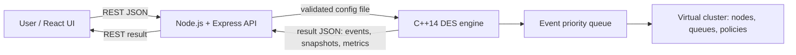
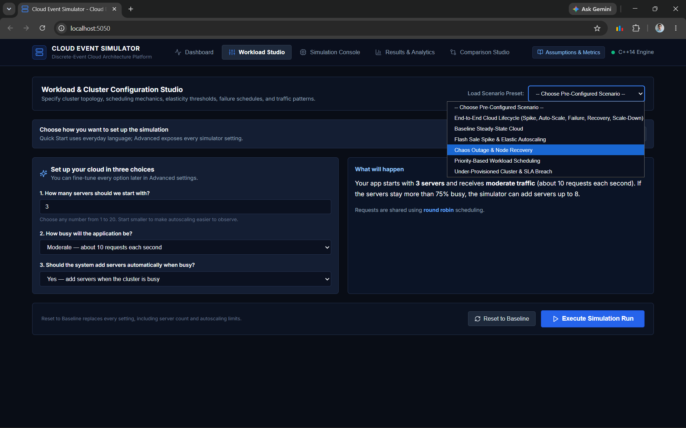
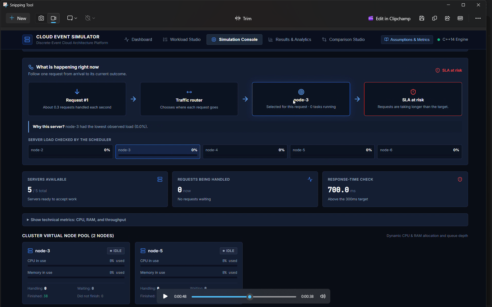

# Feature Reference and Interview Notes

This is the current implementation reference for the Cloud Event Simulator. It describes what the application actually models, why each feature matters, and how to explain the design accurately in an interview or viva.

## Product in one minute

The project is an educational discrete-event simulation (DES) of a cloud cluster. A user configures traffic, servers, scheduling, load balancing, autoscaling, outages, and an SLA. The backend validates the configuration and starts a native C++ simulation. The engine advances **virtual time** from event to event rather than waiting in real time. React then replays the collected telemetry and explains the result.

It is a decision-support and learning tool. It does **not** deploy to AWS/Azure/GCP or emulate real CPU instructions, networking, containers, or a hypervisor.

## Feature map

| Feature | What it models | Why it matters | Main controls |
| --- | --- | --- | --- |
| Virtual cluster | A set of nodes with vCPU, RAM and a bounded task queue | Shows capacity, saturation and the noisy-neighbour problem | Initial nodes, vCPU/RAM per node, queue limit |
| Workload generator | Poisson-style arrivals, duration/resource ranges and priorities | Produces repeatable normal traffic instead of hand-made events | Seed, request rate, task duration, CPU/RAM range, priority ratios |
| Traffic spikes | A finite burst of extra requests | Demonstrates flash sales, launch events and overload | Start time, duration, additional requests |
| Scheduler | Chooses the node that should run a task | Compares policy trade-offs | Round Robin, Least Loaded, Priority Based, First Fit |
| Load balancer | Optionally refines routing between eligible nodes | Separates ingress routing from placement logic | Round Robin, Least Connections, Weighted |
| Autoscaler | Adds/removes nodes from composite resource pressure | Demonstrates elasticity and cost/capacity trade-offs | Thresholds, cooldown, min/max nodes, steps |
| Failure manager | Fails and later recovers a selected node | Demonstrates resilience and task loss under outages | Node ID, failure and recovery time |
| SLA and metrics | Latency, queue wait, percentile latency, throughput, cost and availability | Turns raw activity into an engineering judgement | SLA threshold and cost rates |
| Replay console | Replays snapshots, node states and scheduler decisions | Makes DES understandable to beginners | Timeline, play/pause, speed, step |
| Comparison studio | Runs the same workload with policy variants | Supports a fair, controlled experiment | Experiment type, policies, seed |

## How a request moves through the model

1. The workload generator creates a `REQUEST_ARRIVAL` event.
2. The scheduler selects an eligible node; a non-default load balancer can refine that choice.
3. If CPU and RAM fit, the task starts and a future `TASK_COMPLETE` event is scheduled.
4. If the node lacks capacity but has queue space, the task waits. If the queue is full, it is rejected.
5. Completion frees resources and starts queued work where capacity permits.
6. Periodic metric snapshots capture the exact active nodes, per-node resource usage, queues and status.

At equal timestamps, failure/recovery/completion decisions are ordered before new arrivals so results remain causal and repeatable.

## Autoscaling: how to demonstrate both directions

The autoscaler calculates composite pressure:

`0.60 × CPU utilization + 0.40 × RAM utilization`

- It scales **up** only when pressure is strictly above `scale_up_threshold` and the cluster has fewer than `max_nodes`.
- It scales **down** only when pressure is strictly below `scale_down_threshold` and the cluster has more than `min_nodes`.
- A cooldown prevents an immediate opposite action. This is hysteresis, which prevents flapping.

Use these purpose-built scenarios from the Workload Studio:

- **Autoscaling Story — Scale Up Then Down:** begins with one server; a finite spike adds capacity and the quiet period later removes it.
- **Scale Down — Remove Idle Servers:** begins with six under-used servers and removes one every cooldown period until two remain.

If scale-down is not visible, check three facts first: the run has passed the spike and task-completion period; load is below the down threshold; and the minimum-node count has not already been reached.

## Visual replay: an important accuracy detail

Each metric snapshot now contains its exact node list. The Cluster Virtual Node Pool uses that snapshot, so a replay at `T=10s` shows the nodes that existed at `T=10s`, not nodes created later or nodes removed later.

The "Server load when this request was routed" panel is deliberately historical: it shows the candidates at the selected request's routing time. Its timestamp must be read separately from the main replay clock.

## Why these technologies?

### Why C++14 for the engine?

C++ is used for the event engine because it provides efficient value objects, deterministic standard-library containers, predictable memory use, and low-overhead priority-queue operations. DES repeatedly inserts and removes events; `std::priority_queue` provides `O(log n)` insertion/removal and `O(1)` inspection of the next event. C++ is not automatically “faster” in every situation, but it is a good fit for a CPU-bound deterministic core.

Alternatives:

- **JavaScript/Node.js:** simpler single-language development, but the web server and simulation would compete on one event loop. It is viable for smaller educational simulations.
- **Python:** excellent for prototyping and analysis, but slower for large event counts unless using optimized libraries.
- **Java/Go/Rust:** all are reasonable production choices. Rust offers memory safety; Go simplifies concurrent workers; Java offers mature tooling. The project chooses C++ to demonstrate systems-level modeling and standard containers.

### Why Node.js and Express?

Node.js is the orchestration layer, not the calculation engine. Express exposes a compact JSON API, validates input with Zod, serves the built React application, and starts the C++ executable without a shell. Node is well suited to coordinating file I/O and child processes.

### Why React and Vite?

React maps naturally to a dashboard of reusable components: node cards, metric cards, charts, scenario controls and replay controls. Vite gives fast local development and a small static production bundle. The frontend owns presentation; it does not alter simulation results.

### Why REST/JSON and Server-Sent Events?

REST/JSON is simple to inspect, test and integrate with the browser. JSON also makes a saved simulation result portable. The server has an SSE endpoint for one-way engine progress; the current main UI uses completed-run replay so students can pause, step and inspect a deterministic result. WebSockets would be appropriate for future two-way, in-flight fault injection.

## Architecture and responsibility boundaries

| Layer | Responsibility | It must not do |
| --- | --- | --- |
| React | Collect configuration, display/replay results, compare runs | Perform authoritative simulation arithmetic |
| Express | Validate API input, manage simulation records, invoke engine | Decide scheduling policy or mutate results |
| C++ engine | Generate events, apply policies, produce metrics/snapshots | Trust arbitrary unvalidated web input in production |
| Tests | Verify invariants and endpoint behavior | Substitute for capacity/security testing in deployment |

## Metrics and formulas

- Response latency: `finish time − arrival time`
- Queue wait: `start time − arrival time`
- Execution duration: `finish time − start time`
- Identity: `response latency = queue wait + execution duration`
- Throughput: `completed requests / simulated time`
- SLA compliance: `completed requests within target / completed requests × 100`
- Cost: a simplified capacity-time estimate using configured vCPU-hour and GB-hour prices

Percentiles such as P95 are calculated from completed-task latency samples. They answer "what happens to a slow request?" better than an average alone.

## Security and production limits

Current protections include Helmet headers, a JSON body limit, rate limiting, Zod validation for ordinary simulation creation, argument-array process spawning (not a shell command), and a 45-second child-process watchdog.

For a public deployment, describe these gaps honestly:

- CORS is currently permissive and there is no user authentication or ownership model.
- Simulation records are in memory and disappear on restart.
- The engine runs locally; production should use a queue, worker containers, CPU/memory quotas, persistent storage and object storage for large results.
- `/api/compare/experiment` should receive the same strict payload/budget validation as normal creation.
- Dependencies should be audited continuously in CI.

## Interview answers worth memorising

**What is discrete-event simulation?** It advances a virtual clock to the next meaningful event instead of simulating every millisecond. This is efficient when most time contains no state change.

**Why use a seed?** The same seed and configuration produce the same pseudorandom arrivals and task characteristics, allowing fair policy comparisons and reproducible bugs.

**Scheduler vs load balancer?** The scheduler places a task based on resources and policy; the load balancer distributes incoming traffic. They can overlap in a simplified simulator, but real systems often separate them.

**Why a cooldown?** Without it, a threshold boundary can add and remove nodes repeatedly. Cooldown forces the system to wait before another scaling decision.

**What is the most important limitation?** This is a scalar resource model: it does not model network topology, VM boot time, data locality, heterogeneous instance types, or real cloud billing rules.

## Screenshots

### Beginner-friendly workload setup

### Replay console and scheduler explanation

